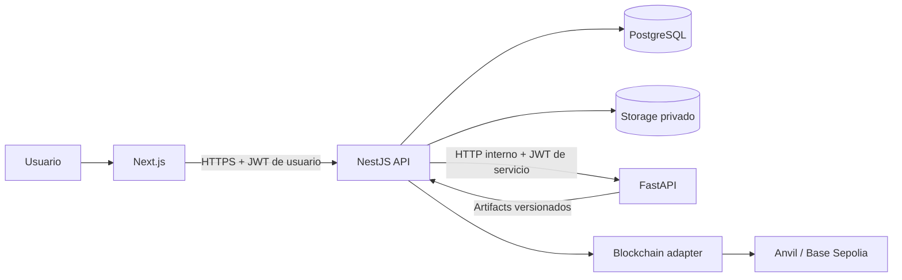
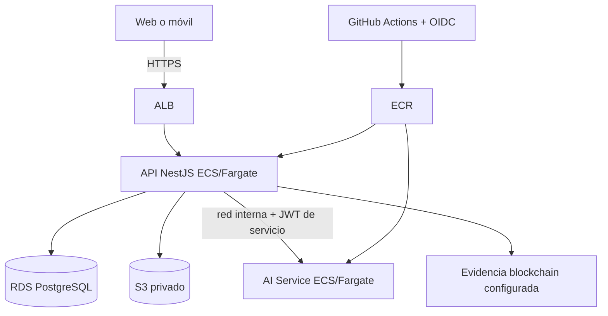
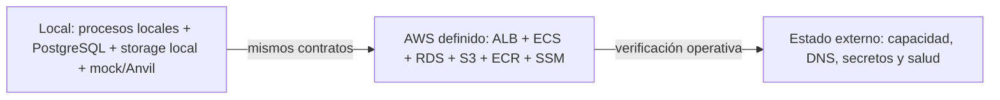

# Arquitectura de despliegue v0

> **Vigencia.** Se conserva esta ruta por continuidad documental. El contenido
> describe la arquitectura AWS definida en el repositorio; no confirma por sí
> mismo qué recursos se encuentran activos en un proveedor externo.

## Proposito

Explicar cómo se relacionan los componentes de Scope en el despliegue definido
en código, sin confundir esa arquitectura con los entornos demo anteriores ni
con el estado operativo observable solo fuera del repositorio.

## Decision

| Componente | Responsabilidad definida |
| --- | --- |
| Aplicación web | Portal institucional, wallet y verificación pública; su alojamiento efectivo se configura fuera del repositorio. |
| ALB | Recibe tráfico HTTPS hacia la API cuando listeners, DNS y servicios están habilitados. |
| API NestJS | Tarea ECS/Fargate y frontera pública de dominio. |
| AI Service | Tarea ECS/Fargate separada, consumida internamente por la API. |
| RDS | Persistencia PostgreSQL del dominio. |
| S3 privado | Evidencia documental fuera de la base de datos. |
| ECR | Imágenes versionadas de API y AI Service. |
| SSM y Secrets Manager | Configuración no secreta, secretos de aplicación y credencial administrada de RDS. |
| CloudWatch | Logs de tareas y alarmas habilitables. |
| GitHub Actions | Publicación de imágenes y operaciones controladas mediante OIDC. |

NestJS conserva autenticación, autorización, reglas de dominio, persistencia,
emisión y coordinación de integraciones. El navegador y la aplicación móvil
consumen solo esa API; no acceden directamente a RDS, S3, el AI Service ni la
capa blockchain.

## Arquitectura logica

## Deployment recomendado

Terraform declara esta topología en `infra/terraform/prod/`. Las compuertas de
capacidad, DNS, certificados y secretos impiden asumir que un recurso está en
servicio solo porque existe en el código.

## Ambientes

Render y Neon pertenecen a una etapa demo anterior. Vercel puede intervenir en
previews o alojamiento web según configuración externa; una integración o
preview no prueba por sí misma alojamiento productivo. La configuración de
ambientes se detalla en `environment-strategy-v0.md`.

## Alcance

- responsabilidades y fronteras de red;
- infraestructura y automatización definidas en código;
- límites entre evidencia versionada y estado externo;
- continuidad de modos blockchain locales.

## Fuera de alcance

- estado Terraform, provisionamiento efectivo, dominios o disponibilidad;
- consultas a AWS, Vercel, proveedores de base de datos o blockchain;
- Base Sepolia operativa o configurada en runtime;
- mainnet, MetaMask o firma desde frontend;
- separacion de NestJS en microservicios.

## Impacto en modulos actuales

- `apps/web` consume `NEXT_PUBLIC_API_BASE_URL` y no recibe secretos;
- `services/api` sigue siendo la única API pública de dominio;
- `DocumentStoragePort` permite alternar local/S3;
- `AiServiceClient` usa una URL interna configurada y JWT de servicio;
- Prisma recibe una URL PostgreSQL configurada fuera del repositorio;
- blockchain mantiene `mock` y Anvil para desarrollo; Base Sepolia requiere
  verificación independiente.

## Riesgos

- capacidad o conectividad no confirmadas de tareas ECS;
- drift entre Terraform, secretos, migraciones e imágenes publicadas;
- CORS incorrecto entre el origen web efectivo y la API;
- secretos ausentes o expuestos;
- introducir Base Sepolia sin configuración, preflight y reconciliación.

## Proximos slices relacionados

La revisión de runbooks demo, migraciones SQL y documentación blockchain se
mantiene como trabajo posterior y no se resuelve en este documento.

